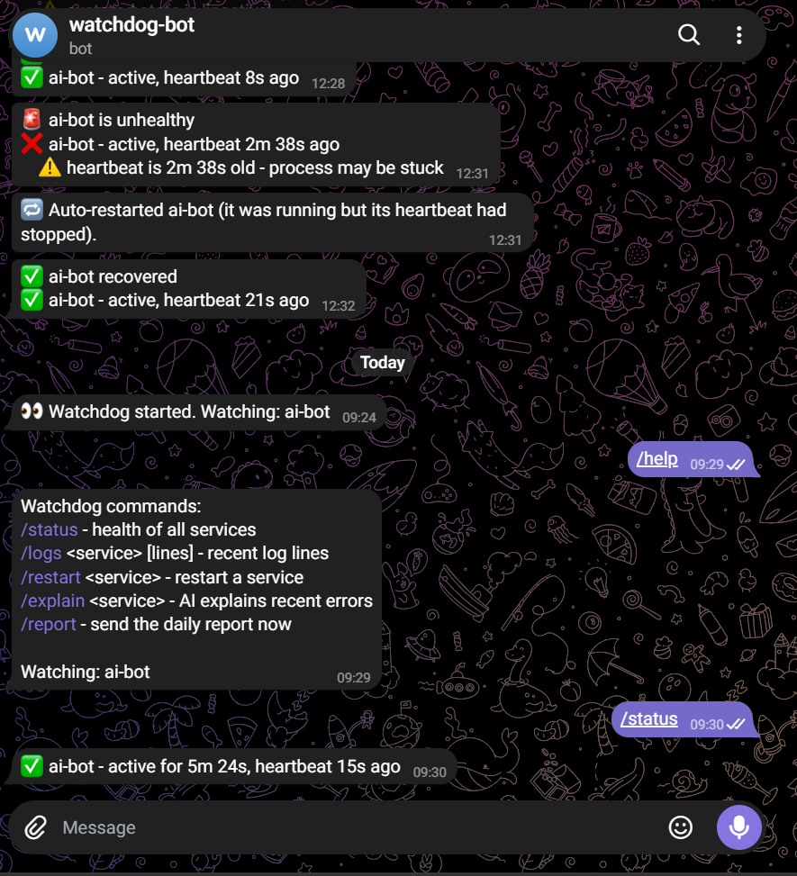
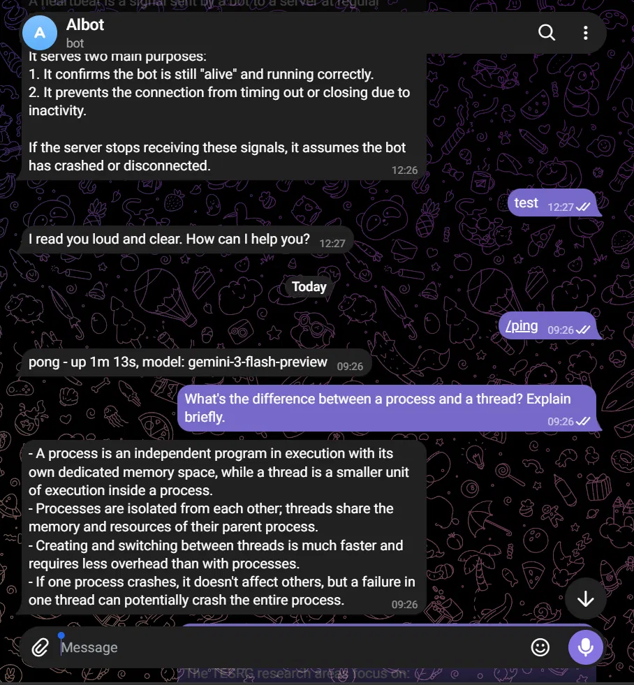

# AI Bot + Watchdog

[](https://github.com/Alifalisda/ai-bot-watchdog/actions/workflows/ci.yml)


Two Telegram bots that run as Linux `systemd` services:

- **AI bot**: answers questions and summarizes long texts with any OpenAI-compatible model (Gemini, OpenAI, Groq, ...).
- **Watchdog bot**: monitors the AI bot (or any systemd service). It alerts on failures, detects a *frozen* process
  and restarts it, shows logs, restarts services from your phone, asks the AI to explain errors, and sends a daily report.

The focus is less "a clever bot" and more **a bot that keeps running and that the next person can operate**:
retries and rate limits, structured logs, least-privilege restarts, a runbook, and tests.

```
           Telegram                                  Linux server (systemd)
 ┌──────────────────────┐                 ┌────────────────────────────────────────┐
 │ users  ──────────────┼────────────────▶│ ai-bot.service ──▶ AI API (Gemini...)  │
 │                      │                 │   └─ writes heartbeat every 30s        │
 │ admin  ◀─ alerts ────┼─────────────────│ watchdog-bot.service                   │
 │        ── /status ──▶│                 │   ├─ systemctl show       (alive?)     │
 │        ── /restart ─▶│                 │   ├─ heartbeat age        (stuck?)     │
 │        ── /explain ─▶│                 │   ├─ journalctl           (logs)       │
 └──────────────────────┘                 │   └─ sudo systemctl restart (whitelist)│
                                          └────────────────────────────────────────┘
```

## Running it for real

Screenshots from the deployment on Ubuntu (WSL2, systemd):

| Watchdog bot | AI bot |
|---|---|
|  |  |
| **Stuck-process test:** the AI bot was frozen with `SIGSTOP`. The watchdog noticed the heartbeat had stopped (12:31), restarted the bot, and reported the recovery (12:32). The next day: `/help` and `/status` after deploying 0.2.0 (now with uptime). | `/ping` reports uptime and the model in use (`gemini-3-flash-preview`). Then a normal question, answered in short bullet points as the system prompt asks. |

## Features

**AI bot** ([`bots/ai_bot.py`](bots/ai_bot.py))
- Per-user sliding-window rate limit (default 5 messages/minute)
- Timeouts and retries with backoff on AI API errors; users get a friendly message instead of silence
- Logs model, token usage and latency for every request (`ai_ok user=... in_tokens=... latency=...`) for cost tracking
- Writes a heartbeat file from its own event loop, so a hung loop is visible from outside

**Watchdog bot** ([`bots/watchdog_bot.py`](bots/watchdog_bot.py))

| Command | What it does |
|---|---|
| `/status` | Health of every watched service (systemd state, uptime, heartbeat age) |
| `/logs <service> [lines]` | Recent log lines from `journalctl` |
| `/restart <service>` | Restarts a whitelisted service |
| `/explain <service>` | Sends recent logs to the AI and returns the likely cause and a suggested fix |
| `/report` | Daily report on demand (also sent automatically at 09:00) |
| `/myid` | Shows your chat ID (for setup) |

## Design decisions

| Decision | Why |
|---|---|
| **Heartbeat file + systemd state**, not just `systemctl is-active` | `Restart=always` handles crashes, but a process that is alive and frozen (deadlock, hung network call) still reports `active`. The heartbeat is written from the bot's event loop, so if the loop hangs, the heartbeat stops. |
| **Auto-restart with a cooldown** (default 10 min) | A bot that's broken at startup would otherwise be restarted forever. After one attempt it alerts a human instead. |
| **Startup grace period** | A freshly restarted service hasn't written a new heartbeat yet. Without a grace period every restart looked "stuck" (see below). |
| **Alert on state change only** | A 3-hour outage produces 2 messages (down, recovered), not 180. |
| **Least privilege** | Both bots run as an unprivileged `botuser`. `sudo` is limited to one exact command (`deploy/sudoers-ai-bots`), service names are checked against a whitelist, and subprocesses run without a shell. Only `ADMIN_CHAT_ID` can run commands. |
| **Any OpenAI-compatible provider** | Changing provider is a `.env` change (`AI_BASE_URL`, `AI_MODEL`), not a code change. |
| **Pure helpers in `utils.py`** | Rate limiting, heartbeat logic and parsing have no Telegram/network imports, so they're unit-tested without mocks. |

## A bug I found and fixed

**Symptom.** On the first deploy, the watchdog reported `ai-bot is unhealthy: no heartbeat file` 15 seconds after
start, then auto-restarted a bot that was working fine. It happened again after every restart.

**Cause.** Two problems together:
1. The heartbeat job was registered with `run_repeating(..., first=0)`, which should fire immediately. The logs showed
   the first write landing a full 30 s after start. The job is registered before the scheduler starts, so its start
   time is already in the past when the scheduler comes up, and the first run moves to the next interval.
2. The watchdog judged a just-restarted service by its heartbeat, which was either missing or left over from the
   previous run.

**Fix.** The AI bot now writes one heartbeat in `post_init`, before it starts polling. The watchdog reads
`ActiveEnterTimestampMonotonic` from `systemctl show` and gives a service a grace period of `HEARTBEAT_MAX_AGE`
after each (re)start ([`heartbeat_problem()`](bots/utils.py), with tests). I verified it on a systemd host:
4 s after a restart, `/status` reports `✅ active for 5s, heartbeat 3s ago` and no false alert. I then froze the
process with `SIGSTOP` to confirm real hangs are still detected and auto-restarted.

## Quick start (local)

Requires Python 3.10+, a Telegram bot token from [@BotFather](https://t.me/BotFather), and an API key
(Gemini has a free tier: [aistudio.google.com](https://aistudio.google.com)).

```bash
git clone https://github.com/Alifalisda/ai-bot-watchdog.git && cd ai-bot-watchdog
python3 -m venv .venv && source .venv/bin/activate   # Windows: .venv\Scripts\activate
pip install -r requirements.txt
cp .env.example .env        # fill in AI_BOT_TOKEN, AI_API_KEY, AI_MODEL
python -m bots.ai_bot
```

The AI bot runs on any OS. The watchdog needs **Linux with systemd**. On Windows, use WSL2 with systemd enabled
(`[boot] systemd=true` in `/etc/wsl.conf`), which behaves like a real server.

## Deploy (Ubuntu VPS or WSL2)

```bash
git clone https://github.com/Alifalisda/ai-bot-watchdog.git && cd ai-bot-watchdog
sudo bash deploy/setup.sh                 # botuser, venv, systemd units, sudoers rule (idempotent)
sudo nano /opt/ai-bots/.env               # tokens and keys
sudo systemctl enable --now ai-bot watchdog-bot
```

Send `/myid` to the watchdog bot, put the number in `ADMIN_CHAT_ID`, then `sudo systemctl restart watchdog-bot`.

Day-to-day operation and incident playbooks: **[RUNBOOK.md](RUNBOOK.md)**.

## Configuration

Everything is configured in `.env`. [`.env.example`](.env.example) lists every option. The main ones:

| Setting | Default | Meaning |
|---|---|---|
| `AI_BASE_URL` / `AI_MODEL` / `AI_API_KEY` | – | Any OpenAI-compatible provider |
| `AI_RATE_LIMIT_PER_MIN` | 5 | Messages per user per minute |
| `WATCHED_SERVICES` | ai-bot | Comma-separated systemd units |
| `HEARTBEAT_FILES` | – | `service=/path` pairs |
| `HEARTBEAT_MAX_AGE` | 120 | Seconds without a heartbeat before a service counts as stuck |
| `AUTO_RESTART_COOLDOWN` | 600 | Minimum seconds between auto-restarts of one service |
| `DAILY_REPORT_TIME` / `TIMEZONE` | 09:00 / Asia/Jakarta | When the daily report is sent |

## Development

```bash
pip install -r requirements-dev.txt
ruff check .
pytest
```

CI runs lint and tests on Python 3.10–3.13 for every push.

## Project layout

```
bots/
  ai_bot.py           AI assistant bot
  watchdog_bot.py     monitoring / ops bot
  common.py           config, logging, AI client
  utils.py            pure helpers (rate limiter, heartbeat logic, parsing), unit-tested
deploy/
  setup.sh            idempotent server setup
  *.service           systemd units (hardened, run as botuser)
  sudoers-ai-bots     the single command the watchdog may run as root
tests/                pytest
RUNBOOK.md            what to do when something breaks + server change log
CHANGELOG.md          code changes per version
```

## License

[MIT](LICENSE)
